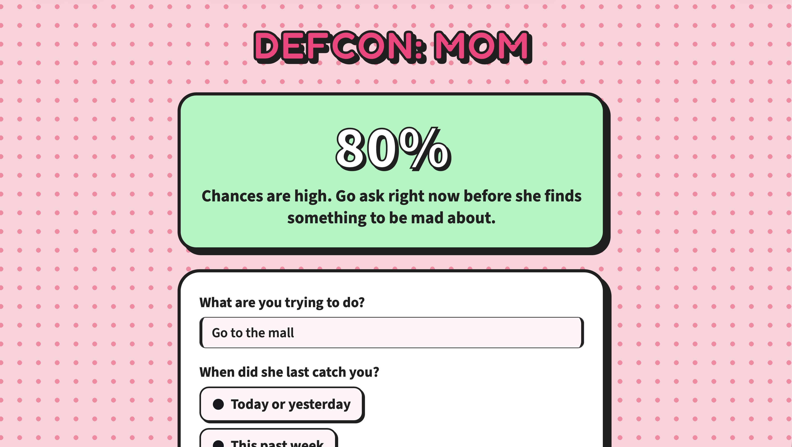
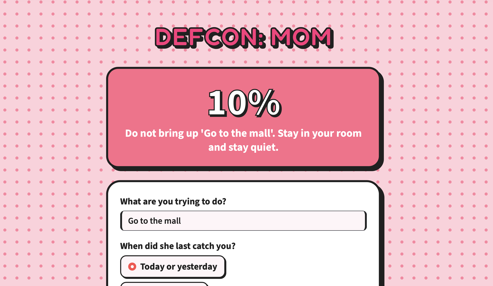

# DEFCON: Mom

A simple calculator to tell you if you should ask mom for something right now or mind your business.

---

## Why this exists

Walking up to mom blindly is a bad idea. If mom is already irritated or you messed up yesterday, asking to go out will just get you yelled at. You need data before you make a move. 

This tool looks at where you stand with mom right now and gives you a percentage chance so you know if it's safe to ask or if you should stay in your room.

---

<p align="center">
  
</p>

<p align="center">
  
</p>

## What it looks at (and why)

### 1. Your Track Record
* **When did she last catch you?** If you got in trouble yesterday, the wound is fresh. If you've been clean for a month, you're in a much better spot.
* **How bad was the incident?** Forgetting a chore is easy to bounce back from; serious trouble takes weeks to recover from.
* **Is she actually over it?** A cold war with heavy sighing means stay away. If she's back to sending memes on WhatsApp, you have a chance.

### 2. Mom's Current Vibe
* **What is she doing right now?** Asking when she's relaxing with tea or coffee is good. Asking when she's stressed and cooking dinner is dangerous.
* **Did you clash in the last 24 hours?** Recent arguments guarantee a low score.
* **Chore status:** If your room is messy and chores are undone, expect a quick rejection.

### 3. Outing Specifics
* **Who is going?** Trusted adults and all-girl groups get a boost. Mixed groups or boys she doesn't know will tank your chances.
* **School standing:** Good recent grades help your case. An upcoming test or bad marks will work against you.
* **Ride logistics:** Having a guaranteed safe ride home makes a yes much more likely than saying you'll "figure out a lift later."

---

## Install dependencies 
```bash 
pip install streamlit pytest
```

## How to run the app
```bash 
streamlit run src/app.py
```
Enter where you want to go, pick your answers, and check your score.


